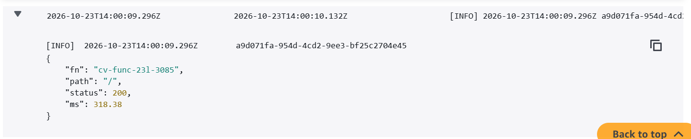
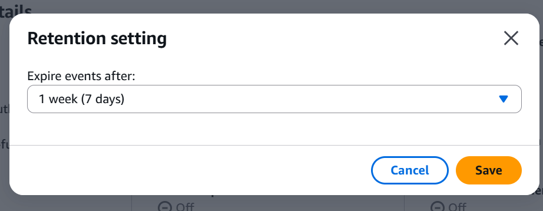

# Host Your CV on AWS

## Overview

This project serves the same CV through two public entry points while keeping the S3 bucket private:

1. **EC2:** A browser requests the EC2 HTTP endpoint. The web server serves `index.html`, `style.css`, and `cv.pdf`. The instance uses an attached IAM role to read objects from S3, and a scheduled sync script refreshes the local web root.
2. **Lambda:** A browser requests the Lambda Function URL over HTTPS. The function uses its execution role to read the requested object from private S3 and returns the appropriate content type.

```text
                         ┌───────────────────────────┐
Browser ── HTTP ────────>│ EC2 web server            │
                         │ scheduled sync script     │
                         └────────────┬──────────────┘
                                      │ EC2 role: GetObject + restricted ListBucket
                                      ▼
                              ┌───────────────┐
                              │ Private S3    │
                              │ site/*        │
                              └───────────────┘
                                      ▲
                                      │ Lambda role: GetObject only
Browser ── HTTPS ───────> Lambda Function URL
```

## Resources

- Region: `ap-southeast-2` (Sydney)
- S3 bucket: `cv-23l-3085`
- EC2 instance: `cv-ec2-23l-3085` (`i-0675d5b64ff31f1d1`)
- EC2 role: `cv-ec2-role-23l-3085`
- Lambda function: `cv-func-23l-3085`
- Lambda role: `cv-lambda-role-23l-3085`
- Security group: `cv-sg-23l-3085`

## S3 contents and privacy

The evidence collection output lists three objects named `index.html`, `style.css`, and `cv.pdf`. Confirm that the keys include the `site/` prefix (`site/index.html`, `site/style.css`, and `site/cv.pdf`) before claiming the exact object paths.

All four S3 Block Public Access settings are enabled, and versioning is enabled. Direct access to the S3 object URL returns HTTP 403, as expected for a private bucket. The `index.html` object retains the `{{HOSTED_ON}}` placeholder in S3; the EC2 and Lambda serving paths replace it in their responses.

## EC2 permission test

[ec2-user@ip-172-31-35-158 ~]$ aws s3 rm s3://cv-23l-3085/site/index.html
delete failed: s3://cv-23l-3085/site/index.html An error occurred (AccessDenied) when calling the DeleteObject operation: User: arn:aws:sts::327260351546:assumed-role/cv-ec2-role-23l-3085/i-0675d5b64ff31f1d1 is not authorized to perform: s3:DeleteObject on resource: "arn:aws:s3:::cv-23l-3085/site/index.html" because no identity-based policy allows the s3:DeleteObject action

[ec2-user@ip-172-31-35-158 ~]$ echo test > /tmp/x && aws s3 cp /tmp/x s3://cv-23l-3085/site/index.html
upload failed: ../../tmp/x to s3://cv-23l-3085/site/index.html An error occurred (AccessDenied) when calling the PutObject operation: User: arn:aws:sts::327260351546:assumed-role/cv-ec2-role-23l-3085/i-0675d5b64ff31f1d1 is not authorized to perform: s3:PutObject on resource: "arn:aws:s3:::cv-23l-3085/site/index.html" because no identity-based policy allows the s3:PutObject action


## EC2 sync log

```
2026-10-23T13:19:16+00:00 sync OK
2026-10-23T13:21:16+00:00 sync OK
2026-10-23T13:23:16+00:00 sync OK
2026-10-23T13:25:17+00:00 sync OK
2026-10-23T13:27:17+00:00 sync OK
2026-10-23T13:29:17+00:00 sync OK
2026-10-23T13:31:17+00:00 sync OK
2026-10-23T13:33:17+00:00 sync OK
2026-10-23T13:35:17+00:00 sync OK
2026-10-23T13:37:17+00:00 sync OK
```


## Endpoint verification

The evidence collection output reported the following results:

| Endpoint              | Observed result                         |
| --------------------- | --------------------------------------- |
| EC2 `/`             | HTTP 200, `text/html; charset=UTF-8`  |
| EC2 `/style.css`    | HTTP 200, `text/css`                  |
| EC2 `/cv.pdf`       | HTTP 200, `application/pdf`           |
| Lambda `/`          | HTTP 200, `text/html; charset=utf-8`  |
| Lambda `/style.css` | HTTP 200, `text/css; charset=utf-8`   |
| Lambda `/cv.pdf`    | HTTP 200, `application/pdf`           |
| Lambda `/anything`  | HTTP 404, `text/plain; charset=utf-8` |
| Direct S3 object URL  | HTTP 403                                |

Verify visually that each homepage footer identifies its actual serving path:

- EC2: `Hosted on: EC2` followed by the instance ID, if that is what your EC2 implementation renders.
- Lambda: the current implementation replaces `{{HOSTED_ON}}` with `Lambda cv-func-23l-3085`.

## IAM and network security

- The EC2 role should have `s3:GetObject` on `arn:aws:s3:::cv-23l-3085/site/*` and `s3:ListBucket` on the bucket restricted to the `site/` prefix.
- The Lambda role should have `s3:GetObject` on `arn:aws:s3:::cv-23l-3085/site/*` and `AWSLambdaBasicExecutionRole` for logging. It does not need `s3:ListBucket`.
- The evidence output showed an extra `cv-lambda-s3-read` inline policy attached to the **EC2 role**. Remove that duplicate policy if it is not part of the lab design; retain `cv-ec2-s3-read` on the EC2 role and `cv-lambda-s3-readonly` on the Lambda role.
- The security group allows HTTP port 80 from `0.0.0.0/0`. SSH port 22 was shown as restricted to `116.58.41.157/32`; confirm this is an approved IP address. Remove temporary SSH rules when no longer needed.
- The instance reports IMDSv2 as required (`HttpTokens: required`) and has the expected EC2 IAM instance profile.

## Lambda logging

The evidence output confirms JSON application log entries containing `fn`, `path`, `status`, and `ms`. The CloudWatch log group `/aws/lambda/cv-func-23l-3085` has retention set to seven days.

Example shape of an application log event (illustrative; use the actual CloudWatch event in your evidence):

```json
{
  "fn": "cv-func-23l-3085",
  "path": "/",
  "status": 200,
  "ms": 42.17
}
```







## Verification checklist

- [ ] EC2 homepage loads and its footer identifies the EC2 serving path.
- [ ] EC2 `/style.css` returns HTTP 200 with a CSS content type.
- [ ] EC2 `/cv.pdf` returns HTTP 200 with `application/pdf`.
- [ ] Lambda homepage loads and footer identifies `Lambda cv-func-23l-3085`.
- [ ] Lambda `/style.css` and `/cv.pdf` return HTTP 200 with the correct content types.
- [ ] Lambda unknown path returns HTTP 404.
- [ ] Direct S3 object URL is denied.
- [ ] S3 Block Public Access is fully enabled and versioning is enabled.
- [ ] Confirm the three expected object keys under `site/`.
- [ ] EC2 role has only the intended S3 read/list permissions; Lambda role has basic logging plus S3 `GetObject`, without `ListBucket`.
- [ ] Security group allows HTTP 80 from anywhere and SSH only from an approved `/32` or has no SSH rule.
- [ ] Instance requires IMDSv2 and has the correct IAM instance profile.
- [ ] Sync script is scheduled at the required interval and its actual log shows at least three consecutive runs.
- [ ] Lambda logs contain `fn`, `path`, `status`, and `ms`; retention is seven days.
- [ ] Temporary SSH rule has been removed.

## Written answers

### 1. Why use roles instead of access keys? What could go wrong if keys were in user data?

EC2 and Lambda can obtain temporary credentials through their attached IAM roles, so long-lived access keys do not need to be stored in the project. If access keys were placed in user data, they could be exposed through logs, screenshots, or repository history. Someone obtaining the keys could use the permissions outside the intended workload. Roles also make it easier to limit permissions and rotate credentials automatically.

### 2. What happens when someone opens the S3 address of `index.html` directly?

The request should be denied because the bucket is private. S3 Block Public Access is enabled, and the lab does not grant public access through a bucket policy or ACL. The website is served through EC2 or Lambda, which use their own IAM roles to read the object.

### 3. What is the public Lambda Function URL permission, and why is it acceptable for the function but not the bucket?

The Function URL is configured for public invocation so visitors can reach the CV website. This is intentional for this public-facing application. The bucket remains private, so visitors cannot directly access or list its objects through S3; the Lambda function retrieves only the configured paths using its execution role.

### 4. Compare the EC2 and Lambda paths when nobody visits and when traffic grows a hundred times.

An EC2 instance can incur compute charges while running even when nobody visits the site. Lambda generally incurs request and execution charges based on use, although other services and limits can also affect cost. EC2 capacity is fixed unless additional scaling is configured, while Lambda can scale with request volume within account and service limits. Actual costs depend on usage, region, and applicable free-tier or credit terms.

### 5. What is lost if the EC2 instance is deleted, and what remains?

The instance's local web-root copy, runtime state, and instance-specific configuration may be lost unless separately backed up. The S3 bucket and its objects remain, as do independently configured IAM roles, the Lambda function, and other separate resources. A replacement instance can be created and repopulated from S3 if the scripts and configuration are retained.

## Adaptations and sources

This project follows the course lab specification. Add links to any official AWS documentation or other resources used to adapt scripts or configuration.
